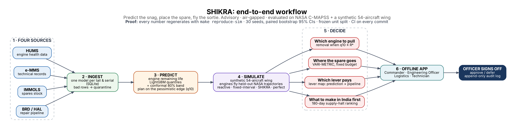

# SHIKRA

**Predict the snag, place the spare, fly the sortie.**

Offline, advisory fleet-availability decision support, evaluated on public NASA C-MAPSS data and a synthetic 54-aircraft wing.

Smart India Hackathon 2026 · Problem Statement `SIH26249` · Ministry of Defence (DSSC)

[](https://www.python.org/downloads/release/python-3110/)
[](https://lightgbm.readthedocs.io/)
[](https://developers.google.com/optimization)
[](https://streamlit.io/)
[](LICENSE)
[](https://github.com/muthukkumaranb/shikra/actions/workflows/ci.yml)
[](https://github.com/muthukkumaranb/shikra/actions/workflows/reproduce-full.yml)

**Contents:** [Problem statement](#problem-statement) · [Overview](#overview) · [Architecture](#architecture) · [Results](#results) · [What did not work](#what-did-not-work) · [Reproduce](#reproduce) · [Installation and usage](#installation-and-usage) · [Repository structure](#repository-structure) · [Documentation](#documentation) · [Scope](#scope) · [Acknowledgements and citation](#acknowledgements-and-citation) · [License](#license)

---

## Problem statement

- **ID**: `SIH26249`
- **Organization**: Ministry of Defence, Defence Services Staff College (DSSC)
- **Theme**: Transportation & Logistics
- **Category**: Software
- **Problem**: Low aircraft availability due to fragmented and largely reactive maintenance practices; data from health monitoring, technical records, spares and maintenance agencies is not adequately integrated.

---

## Overview

- **Inputs**: Ingests read-only nightly batch exports from e-MMS (technical records), IMMOLS (spares stock), HUMS or engine health indicators, and BRD-HAL repair status.
- **Unified Tail & Serial Model**: Ingestion pipeline unifies airframe and component histories into a local SQLite store (`data/unified.db`) protected by an automated data-quality quarantine for malformed or conflicting records.
- **Remaining-Life Model**: LightGBM quantile regression ensemble with conformal 80% prediction bands, planning proactively on the pessimistic edge ($q_{10}$).
- **Wing Simulation**: Discrete-event simulation of a synthetic 54-aircraft wing comparing reactive, fixed-interval preventive, SHIKRA (remove when q10 <= R*), and perfect-prediction oracle policies across 30 seeds with common random numbers and paired bootstrap confidence intervals.
- **Decisions**: Advises removal timing ($q_{10} \le R^*$), spares inventory positioning via two-echelon VARI-METRIC, hangar bay scheduling via CP-SAT constraint programming, sensitivity lever mapping, and 180-day foreign supply halt vulnerability ranking.
- **Officer Sign-off**: Engineering Officer workflow queue with Approve and Defer actions, generating a local cryptographic SHA-256 HMAC tamper-evident audit log (`app_data/audit.db`).
- **Offline Streamlit App**: Air-gapped decision-support dashboard providing role-tailored interfaces for Commander, Engineering Officer, Logistics, Technician, Scenario, and Evidence views.

---

## Architecture



Graphviz source: [docs/assets/shikra_workflow.dot](docs/assets/shikra_workflow.dot)

---

<!-- AUTO-GENERATED — do not edit by hand; run `python scripts/readme_table.py` -->

## Results

### Highlights

| What | Result | Evidence |
|---|---|---|
| RUL accuracy | FD001 RMSE (capped) 11.64 vs 18.45 (Babu 2016 CNN); FD003 14.50 vs 19.82 | [results/rul_cmapss.csv](results/rul_cmapss.csv) |
| Calibrated uncertainty | Held-out empirical coverage 81.0% (FD001) and 79.0% (FD003) at 80% nominal | [results/coverage.csv](results/coverage.csv) |
| Which lever buys readiness | At 0.5x pipeline (fastest): reactive 87.4%, SHIKRA 88.3%, oracle 88.7%; at 1.9x (slowest): reactive 53.6%, SHIKRA 52.9%, oracle 53.4% | [results/heatmap.csv](results/heatmap.csv) |
| Unscheduled engine removals | Reactive 72.7 vs SHIKRA 0.0 per year | [results/policy_summary.csv](results/policy_summary.csv) |
| What to make in India first | Top-2 LRUs: apu_start (21.2 pp), ecs_valve (7.9 pp); foreign halt grounds up to 32 extra aircraft, recovery in 45 days | [results/supply_shock.csv](results/supply_shock.csv) |
| Readiness forecast | Held-out conformal coverage 86.3% (D+3) and 86.5% (D+7) at 80% nominal; MAE does NOT beat persistence (D+7: 2.274 vs 1.552) | [results/readiness_calib.csv](results/readiness_calib.csv) |
| Hangar scheduling | CP-SAT cuts weighted tardiness 174.9 -> 62.3 (-64%) on 200 synthetic instances (never worse than EDF); ties EDF on 60/60 wing snapshots: hangar bays are not the bottleneck | [results/FINDINGS_CPSAT.md](results/FINDINGS_CPSAT.md) |

### RUL Model (LightGBM quantile ensemble, 5 seeds)

Official test sets, last cycle only; RMSE shown against true RUL capped at 125 (piecewise convention) and uncapped.

| Subset | Babu 2016 CNN | RMSE (capped 125) | RMSE (uncapped) | MAE (capped 125) | MAE (uncapped) | NASA Score (capped 125) | NASA Score (uncapped) | RMSE (RUL≤30) | 80% Coverage (uncalibrated) | n units |
|--------|---------------|-------------------|-----------------|------------------|----------------|-------------------------|-----------------------|---------------|-----------------------------|---------|
| FD001 | 18.45 | 11.64 | 12.95 | 8.40 | 9.47 | 204.3 | 235.4 | 3.37 | 61.0% | 100 |
| FD002 | 30.29 | 13.45 | 25.47 | 9.47 | 16.96 | 975.8 | 7291.7 | 3.49 | 66.8% | 259 |
| FD003 | 19.82 | 14.50 | 15.74 | 9.83 | 11.39 | 578.4 | 618.4 | 2.60 | 57.0% | 100 |
| FD004 | 29.16 | 14.33 | 25.99 | 9.48 | 18.17 | 1151.2 | 4446.0 | 7.39 | 55.6% | 248 |

### Fleet Simulation (synthetic wing, 30 replications)

| Policy | Serviceability | 95% CI | Unscheduled removals |
|--------|---------------|--------|---------------------|
| Reactive | 56.5% | [56.0%, 56.9%] | 72.7 |
| Preventive | 47.6% | [47.2%, 48.1%] | 13.2 |
| SHIKRA | 56.3% | [55.7%, 56.8%] | 0.0 |
| Oracle (perfect prediction) | 56.6% | [56.1%, 57.2%] | 0.0 |
| SHIKRA (ablation: without lead-time-aware prepositioning) | 56.2% | [55.6%, 56.8%] | 0.0 |
| Oracle (ablation: without lead-time-aware prepositioning) | 56.5% | [56.0%, 57.1%] | 0.0 |

> **Key Finding:** SHIKRA removes all unscheduled engine removals (0 vs 72.7 per year) but, in this wing, serviceability is unchanged (56.3% vs 56.5%), because the engine-spare pipeline, not warning time, is the binding constraint (see the 'Which lever buys readiness' row in Highlights).

> **Supply-shock stress test (at 1.0× pipeline speed):** A 180-day halt of foreign supply grounds up to 32 extra aircraft of 54 (28.1 pp over the halt); recovery takes 45 days after supply resumes. Ranking: apu_start (21.2 pp), ecs_valve (7.9 pp). Parameters are synthetic; the method is the claim.

> **Prediction-bias stress test (at 1.0× pipeline speed):** −10 cycles wastes 2019 cycles; +10 raises unscheduled removals from 0 to 97.8.

> **Readiness forecast:** At lead 7, forecast MAE is 2.274 vs 1.552 for persistence and Brier is 0.132 vs 0.117; action gains are forecast-estimated and not validated in simulation.

---

## What did not work

- **Prediction alone does not raise serviceability in this wing**: SHIKRA eliminates all unscheduled engine removals (0 vs 72.7 per year), but fleet serviceability is unchanged (56.3% vs 56.5%) because the engine-spare pipeline, not warning time, is the binding constraint on readiness (see [results/heatmap.csv](results/heatmap.csv) and [results/policy_summary.csv](results/policy_summary.csv)).
- **Readiness forecast loses to persistence**: Multi-step readiness forecast MAE loses to a simple persistence baseline across evaluated horizons (at lead 7, forecast MAE is 2.274 vs 1.552 for persistence; see [results/readiness_calib.csv](results/readiness_calib.csv) and [results/FINDINGS_A10.md](results/FINDINGS_A10.md)).
- **Attention-LSTM did not beat LightGBM**: The 2-layer temporal attention-LSTM comparison model achieved comparable RMSE but ~2x worse NASA penalty score on FD003 compared to the LightGBM quantile ensemble (see [results/FINDINGS_T14.md](results/FINDINGS_T14.md)).
- **CP-SAT on the simulated wing**: CP-SAT cuts weighted tardiness 174.9 -> 62.3 (-64%) on 200 synthetic instances (never worse than EDF); ties EDF on 60/60 wing snapshots: hangar bays are not the bottleneck (see [results/FINDINGS_CPSAT.md](results/FINDINGS_CPSAT.md)).
- **Audit log is tamper-evident, not tamper-proof**: The SHA-256 HMAC cryptographic chain guarantees tamper-evidence and detection of post-hoc modifications, but is not tamper-proof against root adversaries because the signing key is stored locally in deployment (see [LIMITATIONS.md](LIMITATIONS.md)).

---

## Reproduce

All committed benchmark results are bitwise-reproducible from a single command:

- **Linux / macOS (`make verify`)**: Runs the full verification pipeline including the 545-day supply-shock simulation (`reproduce-sim`), followed by bitwise validation against all committed CSVs and git diff verification (~73 min).
- **Windows (`scripts/verify.ps1`)**: Windows PowerShell validation. By default, executes the full test suite (`pytest -q -m "not data"`), all simulations EXCEPT the ~65-min supply-shock run, followed by bitwise comparison of committed CSVs (`scripts/check_reproduce.py`) and working tree check (~8 min). Add `-Full` to also regenerate the supply-shock run (~73 min).

### Approximate Benchmark Times (Python 3.11.16)

| Step | Command | Approximate Runtime |
|---|---|---|
| Dependency Installation | `pip install -r requirements.txt` | ~4m 15s |
| Test Suite | `pytest -q -m "not data"` | ~1m 15s |
| Default Verification | `powershell -File scripts/verify.ps1` | ~8 min |
| Full Verification | `make verify` / `verify.ps1 -Full` | ~73 min |

Python 3.11.x is strictly required because pre-built wheels for pinned scientific packages (`numpy==1.26.4`, `scipy==1.13.1`, `lightgbm==4.3.0`) are unavailable on PyPI for Python 3.13+.

> **Windows Note:** If OR-Tools crashes with an access violation, install the Microsoft Visual C++ Redistributable (x64) and restart the shell.

---

## Installation and usage

### 1. Clone

```bash
git clone https://github.com/muthukkumaranb/shikra.git
cd shikra
```

### 2. Environment

```bash
# Linux / macOS
python -m venv .venv
source .venv/bin/activate

# Windows (PowerShell)
python -m venv .venv
.venv\Scripts\Activate.ps1
```

### 3. Install

```bash
pip install --upgrade pip
pip install -r requirements.txt
```

### 4. Verify

```bash
# Linux / macOS
make verify PY=.venv/bin/python

# Windows (PowerShell)
powershell -ExecutionPolicy Bypass -File scripts/verify.ps1 -Py .venv\Scripts\python.exe
```

### 5. Launch the app

```bash
make app
# or
streamlit run app/Home.py
```

The interactive dashboard provides role-tailored pages:
- **Commander**: Lever map (interactive Altair heatmap), supply-shock ranking, readiness forecast panel, and one-page brief.
- **Engineering Officer**: Engine health table, RUL band chart, and sign-off queue.
- **Logistics**: Stock view (engines and 10 LRUs), supply-shock exposure per LRU, and VARI-METRIC allocation panel.
- **Technician**: Snag list: prioritised flight-line snags per tail.
- **Scenario**: Failure-injection walkthrough.
- **Evidence**: Renders GATES.md, policy summary table with CIs, RUL C-MAPSS evaluations, key figures, and reproducibility box.

---

## Repository structure

| Directory | Description |
|---|---|
| `shikra/` | Core Python package: ingestion, feature extraction, RUL models, fleet simulation, inventory optimization, and heuristics |
| `app/` | Offline Streamlit decision-support web application and role dashboards |
| `artifacts/` | Frozen reproducibility artifacts: split definitions, RUL models, baseline replay parquet, and calibration constants |
| `config/` | Wing simulation configurations, LRU Weibull rates, and fleet operational parameters (`config/wing.yaml`) |
| `data/` | Ingestion pipelines, schema validators, quarantine handlers, and mock enterprise extracts |
| `results/` | Committed simulation benchmark CSVs, validation gates, findings memos, and analytical figures |
| `scripts/` | Operational scripts for training, verification, benchmark reproduction, figure generation, and table updates |
| `tests/` | Pytest test suite covering simulation mechanics, RUL variants, audit chaining, and application components |
| `docs/` | System architecture, trustworthy AI mapping, integration specification, and reproducibility audit reports |

---

## Documentation

| Document | Description |
|---|---|
| [MODEL_CARD.md](MODEL_CARD.md) | LightGBM quantile ensemble architecture, training procedure, and conformal prediction bands |
| [DATA_CARD.md](DATA_CARD.md) | NASA C-MAPSS turbofan benchmark structure and synthetic wing operational parameters |
| [LIMITATIONS.md](LIMITATIONS.md) | Scope boundaries, synthetic assumptions, failure modes, and safety constraints |
| [docs/ETAI_MAPPING.md](docs/ETAI_MAPPING.md) | Engineering self-assessment mapped to DRDO's Evaluating Trustworthy AI (ETAI) principles |
| [docs/INTEGRATION.md](docs/INTEGRATION.md) | Read-only enterprise ingestion architecture, data boundaries, and 90-day shadow pilot specification |
| [docs/REPRODUCIBILITY_AUDIT.md](docs/REPRODUCIBILITY_AUDIT.md) | Reproducibility audit of a fresh clone: byte-identical results, runtimes and negative tests |
| [AI_USAGE.md](AI_USAGE.md) | Transparent disclosure of AI assistance, verification protocols, and human design ownership |
| [results/FINDINGS_A10.md](results/FINDINGS_A10.md) | Conformal readiness forecasting findings and persistence baseline comparison |
| [results/FINDINGS_T14.md](results/FINDINGS_T14.md) | Temporal Attention-LSTM benchmark vs LightGBM quantile ensemble |
| [results/FINDINGS_T16.md](results/FINDINGS_T16.md) | Two-echelon VARI-METRIC spares inventory allocation findings |
| [results/FINDINGS_CPSAT.md](results/FINDINGS_CPSAT.md) | Constraint programming (OR-Tools CP-SAT) hangar scheduling findings |

---

## Scope

- **Advisory, never autonomous**: SHIKRA provides decision support and risk bounds for technical officers; it never issues autonomous dispatch directives or replaces maintenance authority.
- **Air-gapped operation**: Designed for standalone deployment with zero external internet connectivity or telemetry.
- **Synthetic wing, not IAF data**: All fleet structures, flight tempos, and maintenance capacities represent a synthetic 54-aircraft wing; no classified or operational Indian Air Force data is used.
- **NASA turbofan data, not fighter-engine telemetry**: Degradation dynamics derive from public NASA C-MAPSS commercial turbofan simulations rather than operational combat aircraft engines.
- **Consumes exports, never replaces source systems**: Operates strictly downstream of e-MMS and IMMOLS via read-only batch exports; source systems remain the sole enterprise systems of record.
- **Tamper-evident, not tamper-proof**: Cryptographic hash chaining detects unauthorized ledger modifications, but does not prevent root-level filesystem alterations where keys reside locally.

---

## Acknowledgements and citation

This project utilizes run-to-failure turbofan degradation data from the NASA Prognostics Center of Excellence (PCoE). If you use this work, please cite:

```
Saxena, A., Goebel, K., Simon, D., & Eklund, N. (2008).
Damage propagation modeling for aircraft engine run-to-failure simulation.
2008 International Conference on Prognostics and Health Management.
```

---

## License

This project is licensed under the MIT License - see the [LICENSE](LICENSE) file for details.
