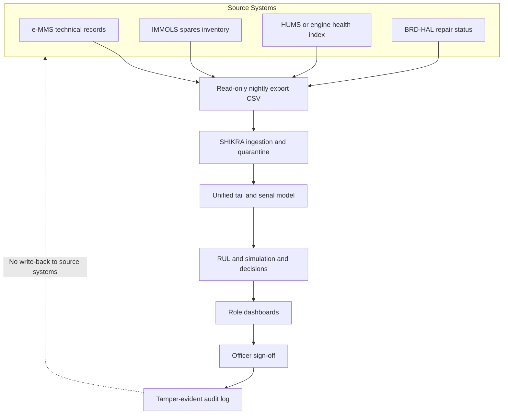

# Integration Architecture and Smallest Pilot Specification

This document details how SHIKRA interfaces with existing maintenance and logistics systems, describes the data handling boundary, and outlines a proposal for a minimal deployable field pilot.

---

## 1. Integration Architecture

SHIKRA is an offline advisory decision-support layer. It operates strictly downstream of operational systems of record via read-only batch exports, providing forward projections and recommendation queues without write-back capability.

---

## 2. Consume, Never Replace

SHIKRA ingests read-only exports; e-MMS and IMMOLS remain the authoritative enterprise systems of record. SHIKRA does not create primary maintenance records, issue dispatch authorizations, or alter stock ledgers:

- **Authoritative Records**: e-MMS remains the sole record of flight hours, airframe life, defect logs, and scheduled inspection sign-offs. IMMOLS remains the sole system of record for spares provisioning, depot holdings, and requisition workflows.
- **Health Index Ingestion**: SHIKRA can ingest external component health summaries—such as the turbofan health monitoring and diagnostics research developed by IAF and IIT Bombay (reported in May 2026)—as an input feature for remaining useful life estimation. SHIKRA has no formal connection to, partnership with, or endorsement by that research programme; it is designed to ingest standard comma-separated condition indicators from any diagnostic source.
- **Unidirectional Data Flow**: Ingestion scripts parse CSV or tabular exports dropped into a secure drop directory. Under no circumstances does SHIKRA establish write channels back into e-MMS, IMMOLS, or flightline networks.

---

## 3. Smallest Deployable Pilot (Proposal)

The following structure is proposed as the minimal viable evaluation framework to validate SHIKRA in an operational context prior to wider deployment:

- **Proposal Status**: Clearly labelled as an advisory evaluation proposal for technical review.
- **Scope & Scale**: One fighter squadron (18–24 airframes); primary engines plus the 10 modelled line-replaceable unit (LRU) types.
- **Interface**: Daily read-only batch export dropped onto local disk at midnight; no automated direct network link.
- **Duration**: 90 calendar days conducted strictly in **shadow mode** (purely advisory; maintenance and flying programmes proceed on established operational guidelines without taking action based on SHIKRA advice).
- **Baseline Re-fitting**: Before running comparisons, baseline repair turnaround times, depot transit delays, vendor lead times, and initial stock quantities must be re-fitted from the squadron's historical export data rather than synthetic parameters.
- **Success Criteria**:
  1. **Calibration Coverage on Real Telemetry**: Empirical coverage of conformal prediction intervals matches or exceeds nominal confidence bounds (evaluated using metrics corresponding to `coverage_80` and `coverage_90` on real component removals).
  2. **Data-Quality Quarantine Rate**: Quarantine mechanism correctly identifies malformed, conflicting, or out-of-order maintenance records with near-zero false alarms on valid entries.
  3. **Officer Sign-off Agreement Rate**: Proportion of advisory recommendations endorsed or accepted by the Engineering Officer during post-hoc review versus rejected or overridden.

---

## 4. Data Handling and Security Boundary

- **Air-Gapped Operation**: SHIKRA runs entirely on a single standalone air-gapped workstation or secure local server.
- **No Internet or External Telemetry**: Zero inbound or outbound networking; web-based telemetry and usage analytics are disabled (`gatherUsageStats = false` in `.streamlit/config.toml`).
- **Local Storage**: All ingested exports, intermediate states, and decisions reside in a local SQLite file store (`app/data/shikra.db`).
- **Local Cryptographic Key**: The HMAC secret key used for signing tamper-evident audit records is stored locally in host environment storage; the resulting audit trail is tamper-evident, not tamper-proof against privileged host administrator modification.
